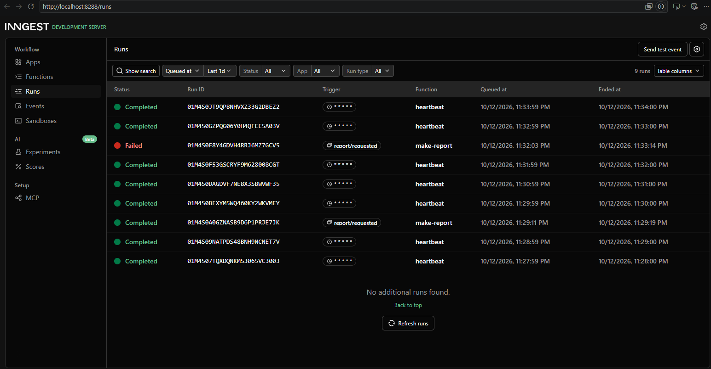

# Your first background job

FlyRank Backend AI Engineering internship - Week 7, assignment BE-06 (A7).

A small API where the slow work (an 8-second report) happens in a background job instead of inside the request. The endpoint answers instantly with `202`, a status endpoint reports progress, and one cron job runs on a schedule with no request involved.

## Stack

Node.js + Express + [Inngest](https://www.inngest.com/) (background jobs, retries, cron - run locally via the Inngest Dev Server, no account needed).

## How to run (two terminals)

```bash
npm install
```

**Terminal 1 - the API:**

```bash
INNGEST_DEV=1 node index.js
```

**Terminal 2 - the Inngest Dev Server:**

```bash
npx inngest-cli@latest dev -u http://localhost:3000/api/inngest
```

Dashboard: http://localhost:8288

## Endpoints & functions

| Type     | Name               | What it does                                                                                                                                                       |
| -------- | ------------------ | ------------------------------------------------------------------------------------------------------------------------------------------------------------------ |
| Endpoint | `GET /health`      | Returns `{ "status": "ok" }`                                                                                                                                       |
| Endpoint | `POST /reports`    | Body `{ "topic": "..." }`. Saves a pending report, sends `report/requested`, returns `202` instantly. `400` if `topic` is missing (no event sent).                 |
| Endpoint | `GET /reports/:id` | Returns the report: `pending` while the job runs, `done` + result after. `404` for an unknown id.                                                                  |
| Function | `say-hello`        | Stage 1 warm-up. Triggered by `test/hello`, sleeps 5s.                                                                                                             |
| Function | `make-report`      | Triggered by `report/requested`. Two steps: `sleep 8s` (stand-in for slow work), then `build-report`. `retries: 2`. Topic `"fail"` always throws, to demo retries. |
| Function | `heartbeat`        | Cron `* * * * *` (every minute). Logs a one-line summary of pending/done/failed report counts. No endpoint, no event - the clock is the only trigger.              |

## Proof - 202 then poll

```
$ time curl -s -i -X POST http://localhost:3000/reports -H "Content-Type: application/json" -d '{"topic":"cats"}'
HTTP/1.1 202 Accepted
{"id":"112aa836-bcfc-4bda-9017-3979bd661182","status":"pending"}
real  0m0.016s

$ curl -s http://localhost:3000/reports/112aa836-bcfc-4bda-9017-3979bd661182
{"id":"112aa836-bcfc-4bda-9017-3979bd661182","topic":"cats","status":"pending"}

# ~10s later
$ curl -s http://localhost:3000/reports/112aa836-bcfc-4bda-9017-3979bd661182
{"id":"112aa836-bcfc-4bda-9017-3979bd661182","topic":"cats","status":"done","result":"Report on \"cats\": cats is a great subject, 3 key insights found."}
```

The request answered in 16ms even though the work behind it takes 8 seconds - that's the whole pattern.

## Dashboard screenshot



## Stage 3 note - validation vs. retry

A missing `topic` is a wrong input and gets rejected at the door with a `400`, no event is ever sent, because retrying bad input would just fail the same way three times. A thrown error inside `build-report` (the `"fail"` topic) is treated as a wrong _moment_ (a hiccup), so Inngest retries it with backoff instead.

## Stretch - idempotency

`build-report` checks the saved status before doing anything: if it's already `"done"`, the step returns immediately. Jobs must survive running twice because at-least-once delivery is the deal every job system makes: a network hiccup or a retry can redeliver the same event, and without this check a redelivered `report/requested` would silently overwrite a finished report (or, with a real side effect like sending an email, send it twice).

## Stage 4 note - cron expressions

- Every day at 08:00: `0 8 * * *`
- Every Sunday at 22:00: `0 22 * * 0`

(Built and checked on [crontab.guru](https://crontab.guru).)

## AI vs me

_[Bonus stage 6 - not attempted yet.]_
